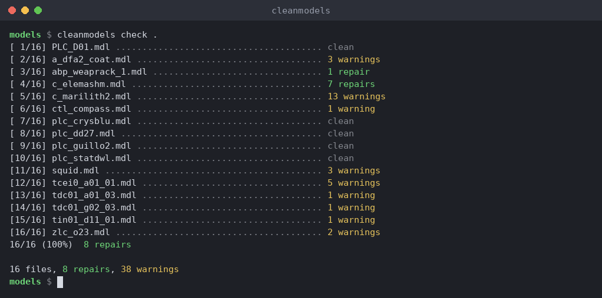
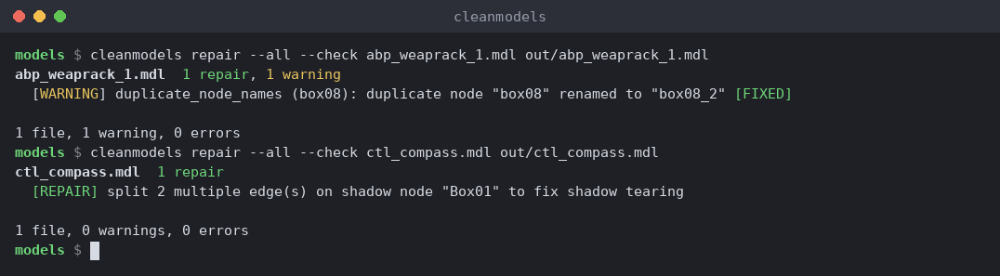
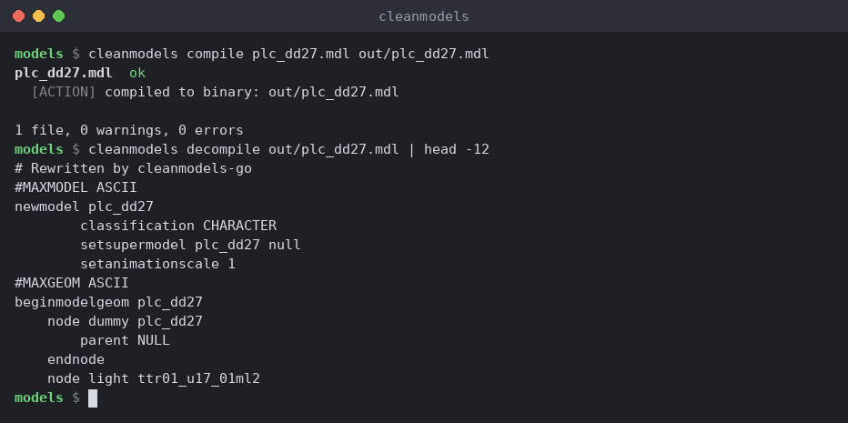
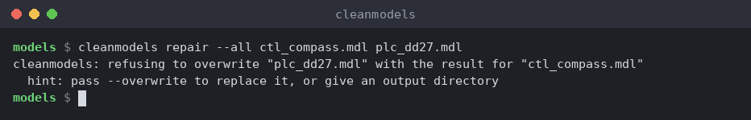
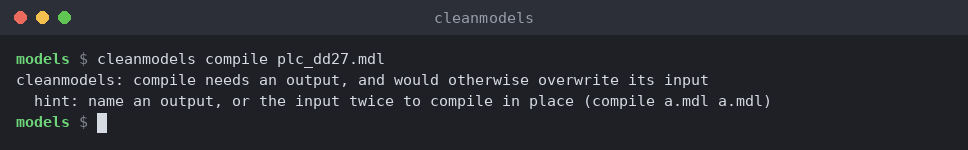
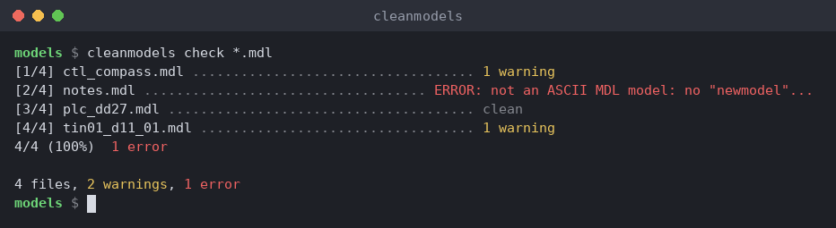

# cleanmodels

Validate, repair, compile, and decompile Neverwinter Nights MDL model files.

A complete rewrite of [OldManBeard's CleanModels](https://neverwintervault.org/project/nwn1/other/tool/cleanmodels-0) in Go — zero dependencies, single static binary, cross-platform.

## Overview

Model files that load in the toolset can still misbehave in game: broken walkmeshes, wrong tile fade data, corrupt texture coordinates, skin weights that do not add up, animations that overrun their length. cleanmodels is the quality gate between your 3D editor (NWMax, Blender) or an inherited hak and the game.

- **Check** a model or a whole folder against 49 rules, with a plain-language explanation of each finding.
- **Repair** what can be repaired automatically (walkmesh pivots, AABB trees, tilefade, degenerate faces and more). Originals are never touched when you write to a separate folder, and the output lists every change it made.
- **Compile and decompile** between ASCII and binary MDL. The compiler follows the engine's own mesh pipeline and is checked against models the game's compiler produced.
- **Script it**: `--json` for one structured result, `--json-lines` for a live event stream. Both are stable and complete, and they are what the GUI uses.



```
$ cleanmodels check amp01_d01_01.mdl
amp01_d01_01.mdl  1 warning
  [WARNING] aabb_fields (Walkmesh_D01): AABB node "Walkmesh_D01" has empty AABB tree (use --fix-aabb to rebuild)

1 file, 1 warning, 0 errors
```

Prefer a window to a terminal? [cleanmodels-qt](https://github.com/plenarius/cleanmodels-qt) is the desktop GUI: drop in a folder, see per-file results, preview the model in 3D. Its downloads include this CLI, so there is nothing else to install.

## Download

Grab the latest binary for your platform from the [Releases](https://github.com/plenarius/cleanmodels/releases) page.

The builds are also on the [Neverwinter Vault](https://neverwintervault.org/project/nwnee/other/tool/clean-models-extended-edition-model-decompile-repair-and-compile). GitHub always has the latest.

| Platform | File |
|---|---|
| Linux (x86_64) | `cleanmodels-linux-amd64.zip` |
| Linux (ARM64) | `cleanmodels-linux-arm64.zip` |
| macOS (Intel) | `cleanmodels-darwin-amd64.zip` |
| macOS (Apple Silicon) | `cleanmodels-darwin-arm64.zip` |
| Windows (x86_64) | `cleanmodels-windows-amd64.zip` |

> **Looking for the legacy Prolog version?** The last Prolog-based release is
> [build3.7.0-HEAD](https://github.com/plenarius/cleanmodels/releases/tag/build3.7.0-HEAD).
> The GUI companion is at [cleanmodels-qt](https://github.com/plenarius/cleanmodels-qt).

## Building from source

Requires [Go 1.26.2 or newer](https://go.dev/dl/) (the version `go.mod` pins; Go 1.21 and later download the right toolchain automatically). No external dependencies.

```
git clone https://github.com/plenarius/cleanmodels
cd cleanmodels
go build -o cleanmodels ./cmd/cleanmodels
```

## Usage

cleanmodels uses subcommands. Run `cleanmodels <command> --help` for full flag details.

Most flags have short aliases for interactive use (e.g. `-r` for `--recursive`, `-v` for `--verbose`). The tables below show both forms.

### Quick start

```bash
# Check a single model
cleanmodels check plc_torch.mdl

# Check an entire directory recursively
cleanmodels check -r models/

# Repair all common issues in a tileset, output to a separate folder
cleanmodels repair -a -r tiles/ repaired/

# Decompile a binary MDL to ASCII
cleanmodels decompile plc_torch.mdl plc_torch.mdl
```

A repair lists every change it made, and compile and decompile work in both directions:





### Batch processing

Point any subcommand at a directory to process all `.mdl` files inside it. No shell loops or scripts needed.

```bash
# See what would be repaired in a folder of models; nothing is written
cleanmodels repair -a models/

# Repair them in place: name the folder twice
cleanmodels repair -a models/ models/

# Recursive (includes subdirectories)
cleanmodels repair -a -r haks/ haks/

# Output to a separate folder (originals untouched)
cleanmodels repair -a -r haks/ cleaned/

# Control parallelism (defaults to CPU count)
cleanmodels repair -a -r -w 4 haks/
```

Several files and directories can be given at once. `check` takes any number of inputs and never writes a file, so a shell glob is safe:

```bash
cleanmodels check *.mdl
cleanmodels check plc_torch.mdl tiles/ more_tiles/
```

For `repair`, `compile` and `decompile`, give several inputs and the **last argument is the output folder**, as with `cp` and `mv`:

```bash
cleanmodels repair -a plc_torch.mdl plc_chest.mdl cleaned/
```

cleanmodels will not replace an existing file with the result for a different input: `cleanmodels repair -a a.mdl b.mdl` stops with an error if `b.mdl` exists, instead of overwriting it. Pass `--overwrite` if that is what you mean. Writing a model over itself (`repair -a a.mdl a.mdl`) and writing into an output folder are always allowed.



`compile` is the same: it needs an output, because with none it would replace your ASCII source with the binary.



A file that is not a model is an error for that file only; the rest of the batch carries on:



A live progress bar is shown automatically when output is a terminal.

### Output and logging

Warnings and progress are written to **stderr**. Structured results (JSON) go to **stdout**. This matters when redirecting output:

```bash
# Save warnings/progress to a file
cleanmodels check -r -v models/ 2> log.txt

# Save everything (stdout + stderr)
cleanmodels check -r -v models/ &> log.txt

# See output on screen AND save to file
cleanmodels check -r -v models/ 2>&1 | tee log.txt

# Machine-readable JSON output
cleanmodels check -r -j models/ > results.json
```

### check — validate models

```bash
cleanmodels check models/
cleanmodels check -r -j haks/
cleanmodels check -f -n plc_torch.mdl
cleanmodels check --exclude-checks emitter_spread,missing_bitmap models/
```

| Flag | Short | Description |
|---|---|---|
| `--fix` | `-f` | Auto-fix safe issues (duplicate names, invalid parents) |
| `--dry-run` | `-n` | Report what would be fixed without writing output |
| `--include-checks` | | Comma-separated check names to run exclusively |
| `--exclude-checks` | | Comma-separated check names to skip |

To see how a skinned model is put together, without sharing the model, run the skin checks verbosely:

```bash
cleanmodels check --verbose --include-checks skin_summary,skin_unknown_bone,skin_influence_count,skin_unbound_vertex,skin_part_binding,skin_skeleton_bone,part_attach_node model.mdl
```

`skin_summary` prints, for each skin node, only names, counts and tree positions: the chain of nodes above it, how many vertices and bones it has, where each bone sits in the node tree (`head_g@4`, marked `(ancestor)` when it is above the skin), and the range of influences and weight sums per vertex. No coordinates are included, so the text can be pasted into a bug report. `skin_unknown_bone` warns when weights name a bone that is not a node of the model, and `skin_influence_count` when a vertex has more than four influences.

Skinned body parts (`pmh0_neck001`, `pfe0_chest003`, ...) are bound in game to the creature skeleton (`pmh0`), hung from the node the part attaches to (`neck_g`), not to the part's own nodes. Heads and robes are the exception: the game loads them as separate objects, so their skins bind to their own nodes like a whole model's. Their bones must be skeleton nodes; `skin_unbound_vertex` warns about vertices left with no usable bone, which the game draws at the origin. For body parts, `skin_skeleton_bone` and `part_attach_node` read the skeleton and its `capart.2da` from the same places compile does (`--game-dir`, `--supermodel-dir`, `--resource-dir`, the model's folder) and warn when a bone or the attach node is missing from it, before a compile would bind the part wrongly. `skin_part_binding` warns when weights name a node called after the part itself (its root `pmh0_neck001`, its meshes `pmh0_neck001g`), which no skeleton has, and `skin_unknown_bone` leaves parts alone. Models exported by NeverBlender 4.0 (the Blender add-on for NWN, which needs Blender 4.0.x) round-trip through cleanmodels with their nodes, skins, dangly meshes and animations intact; NeverBlender rounds positions to 5 decimals and weights to 3. Compiling and decompiling a skinned part needs the skeleton: stock skeletons are read from the game install (`--game-dir`), custom ones from `--supermodel-dir` or `--resource-dir`. A custom skeleton's `capart.2da` (which node each part hangs from) is read from the same places, so keep it next to the model or in the hak you pass. Without it, compile warns that the part will render torn, and decompile leaves the bones unnamed rather than guessing.

### repair — fix and transform models

```bash
cleanmodels repair -a plc_torch.mdl repaired/
cleanmodels repair --fix-pivots --fix-aabb walkables/
cleanmodels repair --scale 2.0 plc_chair.mdl
cleanmodels repair --fix-tilefade --tilefade-z 5.0 tiles/
```

| Flag | Short | Description |
|---|---|---|
| `--all` | `-a` | Enable all structural repairs |
| `--dry-run` | `-n` | Report what would be fixed without writing output |
| `--fix-pivots` | | Repair walkmesh pivot points |
| `--fix-aabb` | | Rebuild AABB trees from walkmesh geometry |
| `--fix-tilefade` | | Slice tile geometry for tilefade |
| `--tilefade-z` | | Z height for tilefade slicing (default: 5.0) |
| `--strip-degenerate` | | Remove zero-area faces |
| `--fix-animations` | | Clamp negative/too-short animation lengths |
| `--reparent-children` | | Reparent children of AABB/light nodes |
| `--wrap-root` | | Wrap non-dummy root nodes in a dummy parent |
| `--split-multiedge` | | Split faces sharing multiple edges |
| `--check` | | Run validation checks after repair |
| `--scale` | | Scale all vertex positions |
| `--scale-x/y/z` | | Scale individual axes |
| `--classification` | | Override classification (CHARACTER, DOOR, EFFECT, ITEM, TILE) |
| `--snap` | | Vertex snapping mode: `binary`, `decimal`, `fine` |
| `--render` | | Force render flag: `all`, `none` |
| `--shadow` | | Force shadow flag: `all`, `none` |
| `--force-white` | | Set ambient/diffuse to 1,1,1 |
| `--merge-by-bitmap` | | Merge sibling trimeshes sharing a bitmap |
| `--cull-invisible` | | Convert invisible meshes to dummy nodes |

### compile — ASCII to binary MDL

```bash
cleanmodels compile plc_torch.mdl plc_torch.mdl
cleanmodels compile -r models/ compiled/

# Body-part models and normal-mapped tiles: let the compiler see the game's data
cleanmodels compile --game-dir "/path/to/Neverwinter Nights" -r parts/ compiled/
cleanmodels compile --resource-dir my_haks/ --resource-dir ts_pbr.hak -r tiles/ compiled/
```

| Flag | Description |
|---|---|
| `--game-dir DIR` | NWN install directory (the one with `data/nwn_base.key`). Stock supermodels and materials are read straight from its BIF files. Defaults to `$NWN_ROOT`, then the usual Steam and GOG install locations. |
| `--resource-dir PATH` | Extra folder, or `.hak`/`.erf`/`.mod` archive, searched for supermodels and for `.mtr` materials (repeatable). The input file's own folder is always searched. |
| `--supermodel-dir DIR` | Extra folder searched for the model's supermodel (repeatable). |

`compile` always needs an output. `cleanmodels compile plc_torch.mdl` on its own is refused, because it would replace your ASCII source with the binary. To compile in place, name the input twice, as in the first example above.

A model's node numbers follow its supermodel, and a mesh whose material is normal-mapped gets tangents baked in, so the compiler needs to find both. If a supermodel can't be found the compile still succeeds and a warning says so. Without materials in reach, only a mesh's own `renderhint` decides about tangents.

Compile looks for the game's data on its own: `--game-dir`, then `$NWN_ROOT`, then the usual Steam and GOG folders for your system (a folder only counts if it holds `data/nwn_base.key`). `--verbose` shows which one was used, and if none is found a one-line note says that materials and supermodels from the game were not consulted. A copy of NWN in an unusual place, or in a second Steam library, needs `--game-dir` or `NWN_ROOT`. Because of this, the same model can compile differently on a machine with NWN installed and one without, when its tangents or node numbers depend on game data; the compile with the data in reach is the correct one.

### decompile — binary to ASCII MDL

```bash
cleanmodels decompile plc_torch.mdl plc_torch.mdl
cleanmodels decompile -f mystery_file.bin output.mdl
```

| Flag | Short | Description |
|---|---|---|
| `--force` | `-f` | Treat input as binary even if auto-detection fails |

### variants — a robe's or armour part's versions for other races and phenotypes

```bash
cleanmodels variants pmh0_robe200.mdl               # every race, phenotypes 0 and 2, next to the source
cleanmodels variants pmh0_chest200.mdl              # the same for an armour part
cleanmodels variants --to pmd0,pmo0 --compile pmh0_robe200.mdl haks/robes/
```

Robes and armour parts are made once per body: `pmh0_chest200` is worn by male humans in phenotype 0, `pmd0_chest200` by male dwarves, and so on. `variants` makes those from one model, fitted to each body with the game's own data; everything it reads comes from the game install (`--game-dir`, found by itself on usual Steam and GOG installs) or `--resource-dir`. Names, node names and the supermodel take the new prefix; bitmaps are kept, as in Bioware's own versions.

- **Robes** take their bone positions from a stock robe of the target body (`pmd0_robe003`), stretch the cloth along each bone to the body's limb lengths (from the race skeletons), and widen or narrow it across each bone by half the difference in the stock body parts' width. A skirt follows the thighs, not the boots.
- **Armour parts** (chest, pelvis, belt, neck, shoulders, biceps, forearms, hands, thighs, shins, feet) are stretched along the bone they hang from to the target skeleton's bone length and scaled across it to the target race's base body part for that slot (`pmd0_chest001`), about that part's centre. Feet, hands, shoulder pads and belts scale in all three directions. Skinned parts (Beamdog's HD parts) are not supported yet.

Checked against Bioware's own versions (the same meshes, refitted by Bioware), mean distance per vertex over every race and gender: robes 003, 004, 006 and 030 3.9 cm (phenotypes 0 and 2); armour parts 1.0 cm in phenotype 0 and 2.4 cm in phenotype 2 (2 to 5 part numbers per slot). Bioware also restyled some by hand (shorter sleeves on dwarves); `variants` keeps the source's design. Make male versions from a male model and female from a female one: the meshes differ. Test robes and armour in game from `override/` or a hak: a model loaded from `development/` shows its palette colours in the wrong places, even Bioware's own.

| Flag | Description |
|---|---|
| `--to LIST` | Comma-separated bodies (`pmd0,pme2`). Default: halfling, dwarf, elf, gnome, human and half-orc in phenotypes 0 and 2, the source's gender, except the source's own body |
| `--compile` | Write compiled (binary) models instead of ASCII |

### Common flags

These flags work with all subcommands:

| Flag | Short | Description |
|---|---|---|
| `--json` | `-j` | Output results as JSON to stdout |
| `--json-lines` | | Stream NDJSON events (for GUI/tool integration) |
| `--verbose` | `-v` | Show all warnings and info |
| `--quiet` | `-q` | Suppress all output except errors |
| `--workers N` | `-w N` | Parallel workers for batch mode (default: CPU count) |
| `--recursive` | `-r` | Process directories recursively |
| `--overwrite` | | Replace an existing output file (never done by default) |

### report — submit a bug report

If you encounter a model that crashes or produces incorrect output, you can submit a report directly from the CLI. Reports are sent to a relay that creates a GitHub issue — no GitHub account required.

```bash
# Report a problematic model
cleanmodels report model.mdl

# Include details about what went wrong
cleanmodels report --error "missing faces after decompile" model.mdl

# Report multiple files with context
cleanmodels report --command "repair --fix-pivots" --notes "visual artifacts" tile1.mdl tile2.mdl
```

| Flag | Description |
|---|---|
| `--command` | The cleanmodels command that was run |
| `--error` | Error output or description of the problem (optional) |
| `--notes` | Additional notes or context |

Found something wrong, or a model that cleanmodels handles badly? Run `cleanmodels report` as above, or [open an issue](https://github.com/plenarius/cleanmodels/issues/new/choose). Include the output of `cleanmodels -v` and, if you can share it, the model file.

### Legacy mode

For backwards compatibility with [cleanmodels-qt](https://github.com/plenarius/cleanmodels-qt) and existing scripts, the old flat-flag interface still works:

```bash
cleanmodels --check --fix-pivots input/ output/
cleanmodels --decompile-only model.mdl output.mdl
```

CleanModels 3's own command line is accepted too, so tools that still generate it (NeverBlender's "detect options" for an external decompiler) keep working: `-d` decompiles only, `-i`/`--indir` and `-o`/`--outdir` are the input and output folders (default the current folder; the output folder is created), `-p`/`--pattern` picks the files (default `*.mdl`), and `-c` sets the classification. As in CleanModels 3, results replace files of the same name in the output folder.

```bash
cleanmodels -d -i models -o ascii -p "c_*.mdl"
```

## What it does

cleanmodels understands the full MDL format for Neverwinter Nights: Enhanced Edition, including all nine geometry node types (dummy, trimesh, danglymesh, skin, animmesh, emitter, light, reference, aabb) and their complete parameter sets.

**Validation** — 56 checks across structural integrity, geometry correctness (including skin bones and weights), parameter bounds, animation consistency, emitter configuration, and tile-specific rules.

**Repair** — Walkmesh pivot point reconstruction, AABB tree rebuilding, tilefade slice computation, degenerate face removal, animation length clamping, and more.

**Variants** — `variants` refits a robe or armour part made for one body to the other races and phenotypes, using the game's own skeletons, body parts and robes.

**Compile/Decompile** — Convert between ASCII and binary MDL formats. The compiler follows the engine's own mesh pipeline (normals, vertex merging, degenerate faces, face adjacency, tangents) and is checked against the NWN:EE game compiler on the engine-compiled models in the test suite. `COMPILE.md` describes how it works; known differences are listed in `RELEASE-v4.md`.

## Specifications

The MDL parser and compiler trace to these references:

- [nwn.wiki MDL Format](https://nwn.wiki/display/NWN1/MDL) — parameter-level documentation
- [xoreos-docs](https://github.com/xoreos/xoreos-docs) — Torlack's binary MDL specification and 010 Editor templates
- [neverwinter.nim](https://github.com/niv/neverwinter.nim) — Nim MDL implementation
- [nwnmdlcomp](https://github.com/nwneetools/nwnmdlcomp) — C++ MDL compiler reference

## License

MIT — see [LICENSE](LICENSE).
